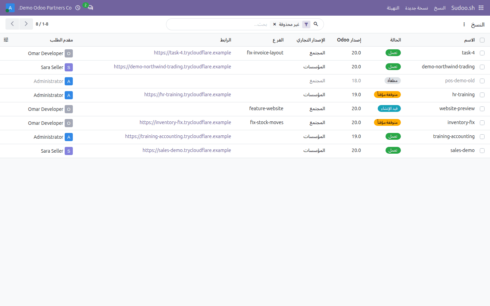
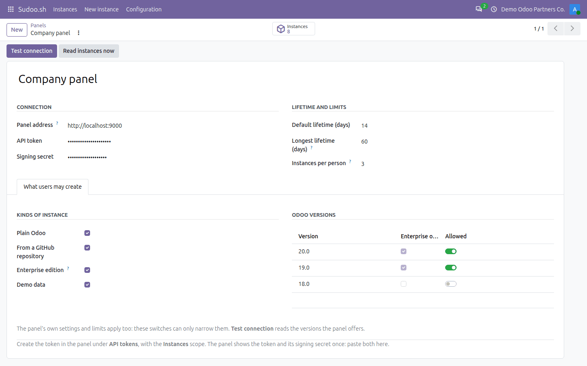
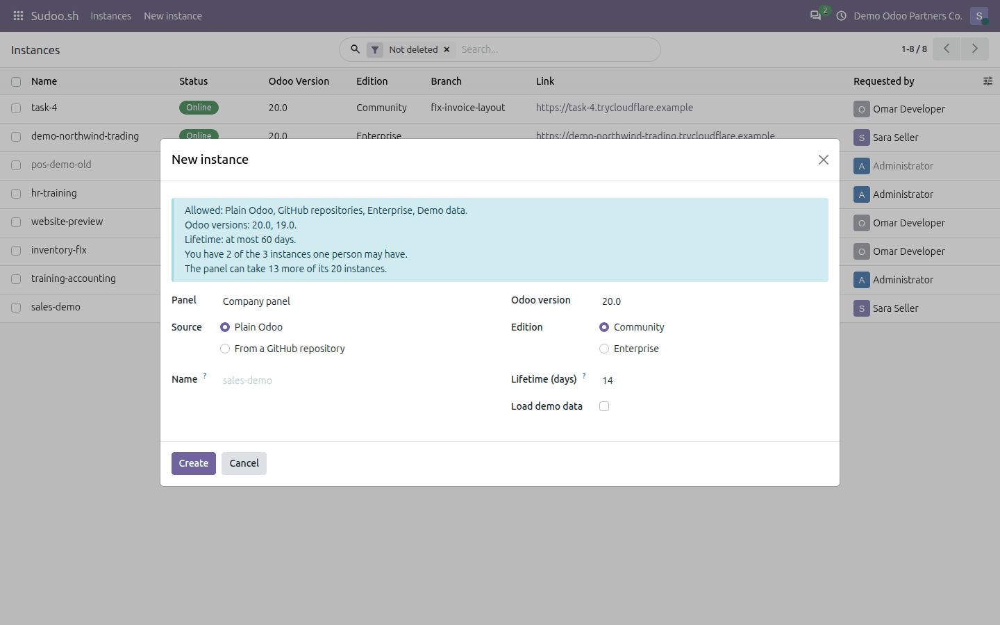
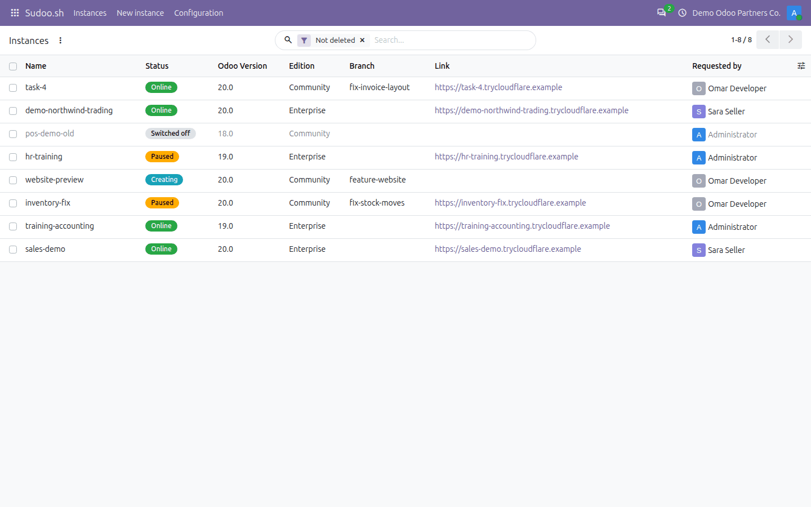
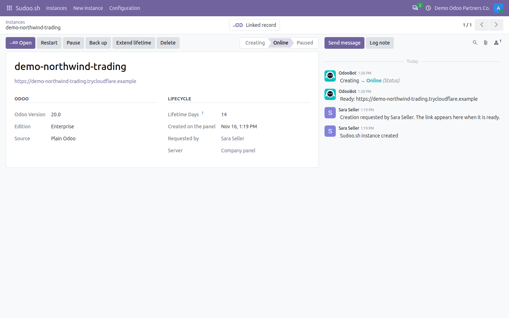
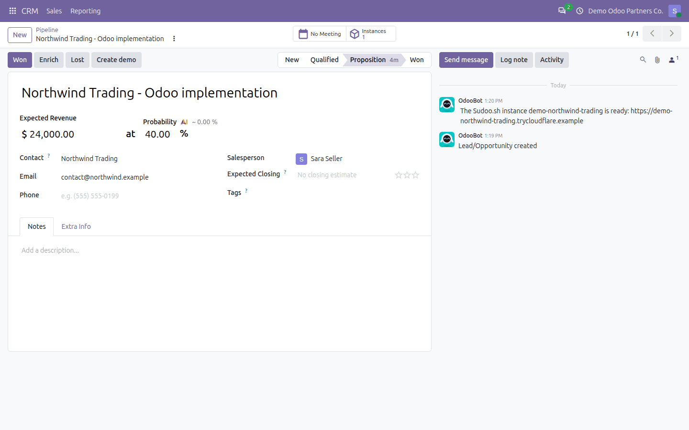
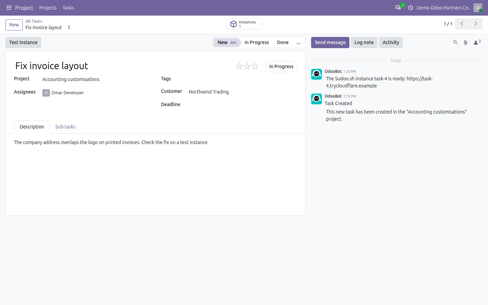

# Sudoo.sh for Odoo User Manual

**Audience:** Everyone who uses the Sudoo.sh apps in Odoo: administrators, users, sales teams, developers and project teams, helpdesk teams.

**Covers:** Odoo 20.0; the apps Sudoo.sh Instance Manager, Sudoo.sh CRM Demos, Sudoo.sh Project Tests and Sudoo.sh Helpdesk Tests. The screens show sample data.

Create and look after your Sudoo.sh Odoo instances (demos, tests, training) from inside your company's own Odoo.

| If you are… | Start with chapters |
| :--- | :--- |
| Setting it up for your company | 1, 2 |
| Creating and looking after instances | 1, 3 |
| In the sales team | 3, 4 |
| A developer or in a project team | 3, 5 |
| In the helpdesk team | 3, 6 |
| Checking a status or fixing a problem | 7, 8 |

_For Odoo 20.0 · November 2026. The apps are also published for Odoo 17.0, 18.0 and 19.0 (branches of the same name); this documentation describes 20.0. The pictures in this manual come from a demonstration system with sample data, so the company, people, instances and links in them are made up._

## Contents

1. [Welcome](#1-welcome)
2. [Administrators: setting things up](#2-administrators-setting-things-up)
3. [Users: working with instances](#3-users-working-with-instances)
4. [Sales: a demo for an opportunity](#4-sales-a-demo-for-an-opportunity)
5. [Developers and projects: a test instance for a task](#5-developers-and-projects-a-test-instance-for-a-task)
6. [Helpdesk: a test instance for a ticket](#6-helpdesk-a-test-instance-for-a-ticket)
7. [What to keep in mind](#7-what-to-keep-in-mind)
8. [Quick reference and common questions](#8-quick-reference-and-common-questions)

## 1. Welcome

Sudoo.sh is a panel that runs Odoo instances on your own server: a demo for a customer, a test of a GitHub branch, a training database. These apps bring that panel into your company's Odoo. You ask for an instance from Odoo, Odoo asks your panel for it, and a minute or two later the link appears in Odoo. From then on you open, pause, restart and back it up from the same screen, and it is deleted by itself when its lifetime is over.

### 1.1 The apps

Install only what you need. Each app brings the Instance Manager with it.

| App | What it adds | Needs |
| :--- | :--- | :--- |
| Sudoo.sh Instance Manager | Panels, what users may create, the instance list, the **New instance** window, and the Open, Start, Pause, Restart, Back up, Extend and Delete buttons | Nothing else |
| Sudoo.sh CRM Demos | A **Create demo** button on opportunities | CRM |
| Sudoo.sh Project Tests | A **Test instance** button on tasks | Project |
| Sudoo.sh Helpdesk Tests | A **Test instance** button on tickets | Helpdesk (Odoo Enterprise) |

Every record that has instances shows an **Instances** smart button, and when an instance is ready its link is posted in that record's chatter.

### 1.2 Who does what

| Who | Where they work | What they do there |
| :--- | :--- | :--- |
| Administrator | Sudoo.sh → Configuration → Panels, and Settings → Users | Connects the panel, decides what users may create, gives people access; also extends lifetimes and deletes instances |
| User | Sudoo.sh → Instances and New instance | Creates instances within the rules, opens, starts, pauses, restarts and backs them up |
| Sales team | CRM: the opportunity | Creates a demo for the prospect with **Create demo** |
| Developers, project team | Project: the task | Creates a test instance of a branch with **Test instance** |
| Helpdesk team | Helpdesk: the ticket | Creates an instance to reproduce a problem or check a fix |

### 1.3 Finding Sudoo.sh in Odoo

Open **Sudoo.sh** from the apps menu (the grid at the top left). The top bar has **Instances**, **New instance** and, for administrators, **Configuration**. If you don't see the app, ask your administrator for the Sudoo.sh **User** access.

### 1.4 Working in Arabic

The apps are available in English and Arabic. Each person picks their language in their own preferences; in Arabic the screens are laid out right to left.

_Figure 1. The instance list in Arabic, laid out right to left._

## 2. Administrators: setting things up

You do this once per panel. Work through the steps in this order.

### 2.1 Install the apps

In **Apps**, search for **Sudoo.sh** and install the apps you want (see 1.1). The main administrator account becomes a Sudoo.sh Administrator by itself.

### 2.2 Connect your panel

1. In your Sudoo.sh panel, open **API tokens** and click **Create token**. Give it a name that says what uses it (for example "Odoo") and the scope **Instances**: it can only list, create, start, pause, restart, back up, extend and delete instances. The panel shows the token and its signing secret **once**: copy both.
2. In Odoo, go to **Sudoo.sh → Configuration → Panels** and click **New**.
3. Give the panel a name, enter its **Panel address** (for example `https://panel.example.com`), and paste the **API token** and the **Signing secret**.
4. Click **Test connection**. Odoo reads the Odoo versions your panel offers and tells you which ones it found.
5. Click **Read instances now** to bring in the instances that already exist on the panel.

> **Important:** The panel address must start with **https://** (plain http is only accepted for a panel on the same machine, `localhost`). Only Sudoo.sh administrators can see the token and the secret; the instances' Odoo passwords are never copied into Odoo.

### 2.3 Decide what users may create

The panel record says what your Odoo users may ask this panel for. The **New instance** window only offers what you allow here, tells users what is not allowed, and checks every rule again when they click **Create**.

_Figure 2. The panel record: connection, lifetime and limits, and the tab What users may create with the Odoo versions and their Allowed switches._

| Setting | What it does |
| :--- | :--- |
| Default lifetime (days) | How long a new instance lives unless the user changes it. After its lifetime the panel deletes it, keeping a backup. |
| Longest lifetime (days) | The most a user may choose. **0** means no limit, and instances may then be kept until someone deletes them. |
| Instances per person | How many instances one Odoo user may have at the same time; **0** means no limit. The panel's own limits apply too. |
| Plain Odoo, From a GitHub repository | Which kinds of instance users may create. |
| Enterprise edition | Whether users may pick Enterprise, for the versions where your panel has it. |
| Demo data | Whether users may load Odoo's demo data. |
| Odoo versions | Read from the panel by **Test connection**. Switch **Allowed** off for a version users should not create. |

These switches can only narrow what the panel itself allows. When your panel starts offering a new Odoo version, click **Test connection** again: the new version appears, allowed.

### 2.4 Give people access

In **Settings → Users**, open a person and pick their level under **Sudoo.sh**:

| Level | What they can do |
| :--- | :--- |
| User | Sees the company's instances, creates instances within your rules, opens, starts, pauses, restarts and backs them up. Users never change instance records directly. |
| Administrator | Everything a User can do, plus connecting panels, setting the rules, extending lifetimes and deleting instances. |

The **Create demo** and **Test instance** buttons appear for people with the Sudoo.sh User level (and access to CRM, Project or Helpdesk).

### 2.5 Keeping the list up to date

Odoo reads the instances of every panel once a minute, so statuses and links follow by themselves. Instances created directly in the panel appear too; their **Requested by** stays empty. To refresh at once, open the panel record and click **Read instances now**.

## 3. Users: working with instances

### 3.1 Create an instance

1. Click **Sudoo.sh → New instance**.
2. Read the blue box: it lists what your administrator allows, the Odoo versions you may pick, the longest lifetime, how many of your own instances you still may have and how much room the panel has left.
3. Choose the **Source**: **Plain Odoo**, or **From a GitHub repository** with its address and branch.
4. Pick the **Odoo version**, the **Edition** (shown only when Enterprise is possible for that version), the **Lifetime (days)** and, if you want them, **Load demo data**.
5. Give it a **Name** if you like; leave it empty and the panel names it after the branch or the version.
6. Click **Create**.

_Figure 3. The New instance window: what is allowed in the blue box, then source, name, version, edition and lifetime._

Odoo opens the new instance with the status **Creating**. When the panel has finished (usually a minute or two), the status becomes **Online**, the link appears and "Ready" is posted in its chatter. With a repository, **Install the repository's modules** (on by default) installs your modules in the new database.

### 3.2 The instance list

**Sudoo.sh → Instances** lists every instance of your panels that is not deleted, with its status, Odoo version, edition, branch, link and who asked for it. Use **Mine** to see only yours, and group by **Status** or **Odoo version**. Click a link to open the instance in a new tab.

_Figure 4. The instance list: online, paused, creating and switched-off instances, with their versions, branches, links and owners._

### 3.3 Open, start, pause, restart and back up

Open an instance from the list. The buttons at the top only show when they make sense for its status.

_Figure 5. An online instance with Open, Restart, Pause, Back up, Extend lifetime and Delete; the chatter shows who asked for it and when it became ready._

| Button | What it does | Shown when |
| :--- | :--- | :--- |
| Open | Opens the instance in a new tab | Online or Paused, with a link |
| Start | Starts it again | Paused, Switched off or Stopped |
| Pause | Stops it to save the server's resources; a visit to its link wakes it up | Online |
| Restart | Restarts Odoo | Online |
| Back up | Takes a backup on the panel | Online or Paused |
| Extend lifetime | Keeps it one default lifetime longer, up to the longest lifetime (administrators) | It has a lifetime and is not deleted |
| Delete | Deletes Odoo, its database and files; the panel takes a backup first (administrators) | Not Creating or Deleted |

While the panel works on a request the status shows **Working**, and the chatter records who asked for it (for example "Back up requested by Sara Seller"). The next refresh shows the result. If the instance was made for an opportunity, task or ticket, **Linked record** takes you back to it.

### 3.4 Extend or delete (administrators)

**Extend lifetime** adds one default lifetime of the panel, but never more than the longest lifetime. **Delete** asks you to confirm, because Odoo, its database and its files are removed; the panel keeps the backup it takes first.

## 4. Sales: a demo for an opportunity

Show a prospect their own Odoo while the deal is open.

1. Open the opportunity in **CRM** and click **Create demo**.
2. The **New instance** window opens with a name made from the customer (for example `demo-Northwind Trading`), Plain Odoo and demo data. Pick the version and edition and click **Create**.
3. When the demo is ready, its link is posted in the opportunity's chatter. The **Instances** smart button lists every demo made for this opportunity.

_Figure 6. An opportunity with the Create demo button, the Instances smart button and the ready link in the chatter._

Give the demo a lifetime that matches the sales cycle. When you need it longer, ask an administrator to extend it.

## 5. Developers and projects: a test instance for a task

Try a branch in a real Odoo before it is merged, and let the task's people see it.

1. Open the task in **Project** and click **Test instance**.
2. The window opens with **From a GitHub repository** chosen and the name `task-` followed by the task number. Enter the repository address (for example `https://github.com/example-org/odoo-addons`) and the branch, then pick the version.
3. Keep **Install the repository's modules** on to have your modules installed, and click **Create**.
4. The link is posted in the task's chatter when the instance is ready, and **Instances** lists it.

_Figure 7. A task with the Test instance button, the Instances smart button and the ready link._

> **Good to know:** The repository address must be a GitHub address (`https://github.com/…` or `git@github.com:…`), and your panel must be able to read that repository.

## 6. Helpdesk: a test instance for a ticket

With the Sudoo.sh Helpdesk Tests app, tickets get a **Test instance** button. It works like the task button: the window opens with the name `ticket-` followed by the ticket number, you pick the source, version and lifetime, and the link is posted in the ticket's chatter when the instance is ready. Use it to reproduce a customer's problem, or to let the customer check a fix.

> **Good to know:** Helpdesk is part of Odoo Enterprise, so this app can only be installed on an Enterprise database. It was built and checked against the code, but it has not yet been tried on a live Enterprise database, which is why this chapter has no picture.

## 7. What to keep in mind

- **You need a Sudoo.sh panel.** These apps do nothing on their own: every instance runs on your panel, within its own limits.
- **Pick the narrowest token.** A token with the **Instances** scope can only do what these apps need. Panels older than that scope only offer **write**, which acts as an Administrator on the panel: update the panel, or keep such a token to Sudoo.sh administrators and revoke it in the panel if it leaks. The Instances scope has not yet been tried against a live panel with these apps.
- **Older panels don't know which Odoo user acted.** Odoo sends the user's login, signed, with every request, and panels with the Instances scope record it in their audit log and per-person limits. Older panels refuse it once, Odoo then carries on without it, and their audit log shows only the token's name. Odoo's own chatter always records who asked.
- **The list refreshes every minute.** A status or link can be up to a minute old; **Read instances now** on the panel record refreshes at once.
- **Helpdesk has not been verified on a live Enterprise database** (see chapter 6).
- **Limits per person count instances requested from Odoo.** Instances created directly in the panel don't count for anyone.

## 8. Quick reference and common questions

### 8.1 Statuses

| Status | What it means |
| :--- | :--- |
| Creating | The panel is building the instance. The link appears when it is ready. |
| Starting | Odoo is starting. |
| Online | Running. **Open** takes you there. |
| Working | The panel is carrying out a request: start, pause, restart, back up or delete. |
| Paused | Stopped to save resources. The first visit to its link starts it again, or click **Start**. |
| Switched off | Stopped, and a visit does not start it. Click **Start**. |
| Stopped | Not running. Click **Start**. |
| Unknown | The panel could not tell. Wait for the next refresh. |
| Deleted | No longer on the panel. Hidden by the **Not deleted** filter. |

### 8.2 If you see… here's what to do

| If you see… | Here's what to do |
| :--- | :--- |
| Your administrator does not allow this kind of instance | Pick the other source (Plain Odoo or a repository), or ask your administrator. |
| Choose one of the Odoo versions your administrator allows | Pick a version from the list; the others are switched off on the panel record. |
| Enterprise is not available for Odoo … here | Choose Community, or another version that has Enterprise. |
| The lifetime must be between 1 and … days | Lower the lifetime; ask an administrator to extend it later. |
| You already have … instances, the most one person may have | Delete one of yours (ask an administrator), or wait for one to reach its lifetime. |
| Enter the GitHub repository's address | Use the full address, for example `https://github.com/acme/odoo-addons`. |
| The panel refused this: … | The panel's own rule or limit stopped it; the message says which. |
| The panel at … could not be reached | Check the **Panel address**; ask whoever runs the panel whether it is up. |
| The panel at … answered with a redirect | The address is not the panel's own address; correct it, usually with https://. |
| The panel address must start with https:// | Enter the address with https:// (http only for localhost). |
| Only Sudoo.sh administrators can do this | Extending and deleting are for administrators; ask one. |
| This instance has no link yet | It is still being created; wait for the next refresh. |
| No **Create demo** or **Test instance** button | You need the Sudoo.sh User level; ask your administrator. |

---

Sudoo.sh for Odoo · Proprietary software of Sudoo.sh, free to use · The screens show sample data. Odoo is a trademark of Odoo S.A.; Sudoo.sh is not affiliated with Odoo S.A.
